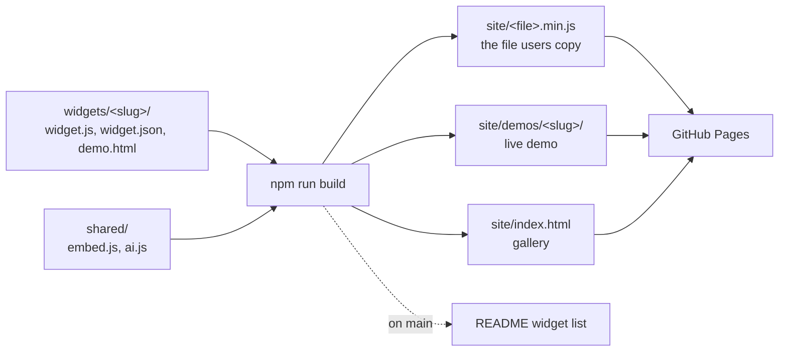

# JS Widgets

Standalone JavaScript widgets you can add to any site with one paste. No dependencies, no build step, no account.

**[Try every widget in the live gallery](https://adamsilverstein.github.io/js-widgets/)**. Each one has a working demo and a copy button.

## Using a widget

Find a widget in the gallery, copy its snippet, and paste it into your page where you want it to appear:

```html
<script src="https://adamsilverstein.github.io/js-widgets/eyes.min.js" data-size="64"></script>
```

Widgets are configured with `data-` attributes on the script tag. The gallery offers two ways to copy each one:

- **Copy snippet** gives you the short script tag above, loading the file from this project's GitHub Pages site.
- **Copy inline JS** gives you the whole minified widget inside one script tag, so your page loads nothing from another server.

You can also download a `.min.js` file from the gallery and host it yourself.

## Widgets

<!-- widgets:start -->
_No widgets yet._
<!-- widgets:end -->

## How it fits together



Every widget lives in its own directory. The build minifies it, wraps its demo, and adds it to the gallery under its category. Nothing else needs editing to add a widget.

## Development

```sh
nvm use
npm install
npx playwright install chromium   # once, for the tests
npm run dev                       # gallery at http://localhost:8080, rebuilds on change
npm test                          # build, check size budgets, load every demo in a browser
```

See [CONTRIBUTING.md](CONTRIBUTING.md) for how to add a widget and the conventions every widget follows.

## License

[MIT](LICENSE). Copy the widgets into any site, personal or commercial.
