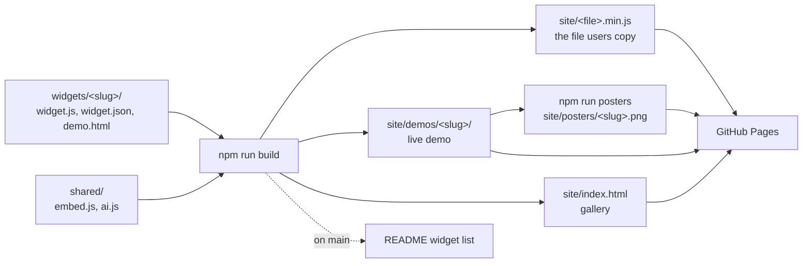

# JS Widgets

Standalone JavaScript widgets you can add to any site with one paste. No dependencies, no build step, no account.

**[Try every widget in the live gallery](https://adamsilverstein.github.io/js-widgets/)**. Each one has a working demo, options you can change in place, and a copy button. Below, click a picture to open that widget's demo, or open "Copy a snippet" under any group and use the copy button on the code.

## Using a widget

Find a widget in the gallery, copy its snippet, and paste it into your page where you want it to appear:

```html
<script src="https://adamsilverstein.github.io/js-widgets/eyes.min.js" data-size="64"></script>
```

Widgets are configured with `data-` attributes on the script tag. The gallery offers two ways to copy each one:

- **Copy snippet** gives you the short script tag above, loading the file from this project's GitHub Pages site.
- **Copy inline JS** gives you the whole minified widget inside one script tag, so your page loads nothing from another server.

You can also download a `.min.js` file from the gallery and host it yourself.

## Widgets

<!-- widgets:start -->
### Fun and effects

Small delights that give a page some personality.

<table>
<tr>
<td width="33%" valign="top">
<a href="https://adamsilverstein.github.io/js-widgets/#ascii-cinema"></a><br>
<b><a href="widgets/ascii-cinema">ASCII Cinema</a></b> <sub>3.0 KB</sub><br>
<sub>Plays a video as live ASCII art, with a click to switch back to the real picture.</sub>
</td>
<td width="33%" valign="top">
<a href="https://adamsilverstein.github.io/js-widgets/#confetti-cannon"></a><br>
<b><a href="widgets/confetti-cannon">Confetti Cannon</a></b> <sub>1.6 KB</sub><br>
<sub>Celebrates a click, or any moment your code chooses, with a burst of confetti.</sub>
</td>
<td width="33%" valign="top">
<a href="https://adamsilverstein.github.io/js-widgets/#googly-eyes"></a><br>
<b><a href="widgets/googly-eyes">Googly Eyes</a></b> <sub>1.9 KB</sub><br>
<sub>A pair of eyes that follows the visitor's pointer around the page, blinks, and goes wide on click.</sub>
</td>
</tr>
<tr>
<td width="33%" valign="top">
<a href="https://adamsilverstein.github.io/js-widgets/#mini-synth"></a><br>
<b><a href="widgets/mini-synth">Mini Synth</a></b> <sub>5.2 KB</sub><br>
<sub>A two octave keyboard visitors can play with a mouse, touch, their computer keyboard or a MIDI controller.</sub>
</td>
<td width="33%" valign="top">
<a href="https://adamsilverstein.github.io/js-widgets/#pet-companion"></a><br>
<b><a href="widgets/pet-companion">Pet Companion</a></b> <sub>4.2 KB</sub><br>
<sub>A tiny pixel cat that wanders along the bottom of the page, chases the pointer, naps and purrs when clicked.</sub>
</td>
<td width="33%" valign="top">
<a href="https://adamsilverstein.github.io/js-widgets/#tag-cloud-sphere"></a><br>
<b><a href="widgets/tag-cloud-sphere">Tag Cloud Sphere</a></b> <sub>4.1 KB</sub><br>
<sub>Turns a list of tag links into a rotating 3D globe you can drag to spin, with every tag still a real link.</sub>
</td>
</tr>
<tr>
<td width="33%" valign="top">
<a href="https://adamsilverstein.github.io/js-widgets/#tilt-card"></a><br>
<b><a href="widgets/tilt-card">Tilt Card</a></b> <sub>2.3 KB</sub><br>
<sub>Gives any element a 3D tilt toward the pointer and a holographic shine that moves with the angle.</sub>
</td>
</tr>
</table>

<details>
<summary>Copy a snippet</summary>

**ASCII Cinema** &nbsp; [options](widgets/ascii-cinema#options)

```html
<script src="https://adamsilverstein.github.io/js-widgets/ascii.min.js" data-src="clip.mp4" data-cols="100" data-color="#33ff66"></script>
```

**Confetti Cannon** &nbsp; [options](widgets/confetti-cannon#options)

```html
<script src="https://adamsilverstein.github.io/js-widgets/confetti.min.js" data-trigger=".celebrate" data-colors="#f60,#09f,#fc0"></script>
```

**Googly Eyes** &nbsp; [options](widgets/googly-eyes#options)

```html
<script src="https://adamsilverstein.github.io/js-widgets/eyes.min.js" data-size="64" data-color="#222"></script>
```

**Mini Synth** &nbsp; [options](widgets/mini-synth#options)

```html
<script src="https://adamsilverstein.github.io/js-widgets/synth.min.js" data-octaves="2" data-wave="sine"></script>
```

**Pet Companion** &nbsp; [options](widgets/pet-companion#options)

```html
<script src="https://adamsilverstein.github.io/js-widgets/pet.min.js" data-pet="cat"></script>
```

**Tag Cloud Sphere** &nbsp; [options](widgets/tag-cloud-sphere#options)

```html
<script src="https://adamsilverstein.github.io/js-widgets/sphere.min.js" data-target=".wp-block-tag-cloud" data-radius="140"></script>
```

**Tilt Card** &nbsp; [options](widgets/tilt-card#options)

```html
<script src="https://adamsilverstein.github.io/js-widgets/tilt.min.js" data-target=".card" data-max="15" data-shine="holo"></script>
```

</details>

### Reading tools

Help visitors get through long articles.

<table>
<tr>
<td width="33%" valign="top">
<a href="https://adamsilverstein.github.io/js-widgets/#find-on-page"></a><br>
<b><a href="widgets/find-on-page">Find on Page</a></b> <sub>4.4 KB</sub><br>
<sub>A floating search box that highlights every match in the page's content and steps through them, without rewriting the markup.</sub>
</td>
<td width="33%" valign="top">
<a href="https://adamsilverstein.github.io/js-widgets/#listen-to-page"></a><br>
<b><a href="widgets/listen-to-page">Listen to This Page</a></b> <sub>5.0 KB</sub><br>
<sub>Reads an article aloud with the browser's own voices and highlights each sentence as it is spoken.</sub>
</td>
<td width="33%" valign="top">
<a href="https://adamsilverstein.github.io/js-widgets/#reading-progress"></a><br>
<b><a href="widgets/reading-progress">Reading Progress</a></b> <sub>1.5 KB</sub><br>
<sub>A bar across the top of the page that fills as the reader moves through an article, with an estimate of the minutes left.</sub>
</td>
</tr>
</table>

<details>
<summary>Copy a snippet</summary>

**Find on Page** &nbsp; [options](widgets/find-on-page#options)

```html
<script src="https://adamsilverstein.github.io/js-widgets/find.min.js" data-target="main" data-hotkey="/"></script>
```

**Listen to This Page** &nbsp; [options](widgets/listen-to-page#options)

```html
<script src="https://adamsilverstein.github.io/js-widgets/listen.min.js" data-target="article" data-rate="1"></script>
```

**Reading Progress** &nbsp; [options](widgets/reading-progress#options)

```html
<script src="https://adamsilverstein.github.io/js-widgets/progress.min.js" data-target="article" data-color="#f60"></script>
```

</details>

### Site utilities

Practical things most sites end up needing.

<table>
<tr>
<td width="33%" valign="top">
<a href="https://adamsilverstein.github.io/js-widgets/#contact-card"></a><br>
<b><a href="widgets/contact-card">Contact Card</a></b> <sub>5.8 KB</sub><br>
<sub>A floating button that opens call and email links and a short contact form.</sub>
</td>
<td width="33%" valign="top">
<a href="https://adamsilverstein.github.io/js-widgets/#dark-mode-toggle"></a><br>
<b><a href="widgets/dark-mode-toggle">Dark Mode Toggle</a></b> <sub>3.1 KB</sub><br>
<sub>A sun and moon button that switches the page between light and dark, remembers the choice and reveals the new theme in a circle.</sub>
</td>
<td width="33%" valign="top">
<a href="https://adamsilverstein.github.io/js-widgets/#local-weather"></a><br>
<b><a href="widgets/local-weather">Local Weather</a></b> <sub>6.0 KB</sub><br>
<sub>Current conditions and a three day forecast from Open-Meteo, with no API key.</sub>
</td>
</tr>
<tr>
<td width="33%" valign="top">
<a href="https://adamsilverstein.github.io/js-widgets/#speed-badge"></a><br>
<b><a href="widgets/speed-badge">Speed Badge</a></b> <sub>2.0 KB</sub><br>
<sub>A tiny badge showing how fast the page loaded, which opens to live LCP, CLS and INP for the current visit.</sub>
</td>
</tr>
</table>

<details>
<summary>Copy a snippet</summary>

**Contact Card** &nbsp; [options](widgets/contact-card#options)

```html
<script src="https://adamsilverstein.github.io/js-widgets/contact.min.js" data-phone="+15415550100" data-email="hello@example.com" data-endpoint="https://example.com/contact"></script>
```

**Dark Mode Toggle** &nbsp; [options](widgets/dark-mode-toggle#options)

```html
<script src="https://adamsilverstein.github.io/js-widgets/theme.min.js" data-position="top-right"></script>
```

**Local Weather** &nbsp; [options](widgets/local-weather#options)

```html
<script src="https://adamsilverstein.github.io/js-widgets/weather.min.js" data-lat="44.05" data-lon="-121.31" data-units="f" data-label="Bend, OR"></script>
```

**Speed Badge** &nbsp; [options](widgets/speed-badge#options)

```html
<script src="https://adamsilverstein.github.io/js-widgets/speed.min.js" data-metric="lcp"></script>
```

</details>

### On-device AI

Built on Chrome's built-in AI. No API key, no server, nothing leaves the device.

> [!NOTE]
> These use Chrome's built-in AI, so they need a recent desktop Chrome. In other browsers they render nothing and the page works as before.

<table>
<tr>
<td width="33%" valign="top">
<a href="https://adamsilverstein.github.io/js-widgets/#alt-text-helper"></a><br>
<b><a href="widgets/alt-text-helper">Alt Text Helper</a></b> <sub>7.0 KB</sub><br>
<sub>Add ?alt-audit to a page to list images missing alt text and draft a description for each with on-device AI.</sub>
</td>
<td width="33%" valign="top">
<a href="https://adamsilverstein.github.io/js-widgets/#ask-this-page"></a><br>
<b><a href="widgets/ask-this-page">Ask This Page</a></b> <sub>6.6 KB</sub><br>
<sub>A corner chat panel that answers visitor questions from the page's own text, using an AI model that runs on the visitor's device.</sub>
</td>
<td width="33%" valign="top">
<a href="https://adamsilverstein.github.io/js-widgets/#comment-helper"></a><br>
<b><a href="widgets/comment-helper">Comment Helper</a></b> <sub>4.7 KB</sub><br>
<sub>Adds Fix grammar, Friendlier and Shorter buttons under a textarea, with suggestions written on the visitor's device.</sub>
</td>
</tr>
<tr>
<td width="33%" valign="top">
<a href="https://adamsilverstein.github.io/js-widgets/#explain-this"></a><br>
<b><a href="widgets/explain-this">Explain This</a></b> <sub>4.8 KB</sub><br>
<sub>Select a word or phrase to get a short, plain language explanation that fits the paragraph it sits in.</sub>
</td>
<td width="33%" valign="top">
<a href="https://adamsilverstein.github.io/js-widgets/#tldr-button"></a><br>
<b><a href="widgets/tldr-button">TL;DR Button</a></b> <sub>3.9 KB</sub><br>
<sub>A button that summarizes the article into three key points, generated on the visitor's device with no server or API key.</sub>
</td>
<td width="33%" valign="top">
<a href="https://adamsilverstein.github.io/js-widgets/#translate-page"></a><br>
<b><a href="widgets/translate-page">Translate This Page</a></b> <sub>3.4 KB</sub><br>
<sub>A language picker that translates an article in place on the visitor's device, with a button to show the original.</sub>
</td>
</tr>
</table>

<details>
<summary>Copy a snippet</summary>

**Alt Text Helper** &nbsp; [options](widgets/alt-text-helper#options)

```html
<script src="https://adamsilverstein.github.io/js-widgets/alt.min.js" data-param="alt-audit"></script>
```

**Ask This Page** &nbsp; [options](widgets/ask-this-page#options)

```html
<script src="https://adamsilverstein.github.io/js-widgets/ask.min.js" data-target="main" data-greeting="Ask me about this page"></script>
```

**Comment Helper** &nbsp; [options](widgets/comment-helper#options)

```html
<script src="https://adamsilverstein.github.io/js-widgets/write.min.js" data-target="#comment, .contact-form textarea"></script>
```

**Explain This** &nbsp; [options](widgets/explain-this#options)

```html
<script src="https://adamsilverstein.github.io/js-widgets/explain.min.js" data-target="article" data-level="simple"></script>
```

**TL;DR Button** &nbsp; [options](widgets/tldr-button#options)

```html
<script src="https://adamsilverstein.github.io/js-widgets/tldr.min.js" data-target="article" data-type="key-points" data-length="short"></script>
```

**Translate This Page** &nbsp; [options](widgets/translate-page#options)

```html
<script src="https://adamsilverstein.github.io/js-widgets/translate.min.js" data-target="article" data-languages="es,fr,de,ja"></script>
```

</details>
<!-- widgets:end -->

## How it fits together



Every widget lives in its own directory. The build minifies it, wraps its demo, and adds it to the gallery under its category. Nothing else needs editing to add a widget.

## Development

```sh
nvm use
npm install
npx playwright install chromium   # once, for the tests
npm run dev                       # gallery at http://localhost:8080, rebuilds on change
npm test                          # build, check size budgets, load every demo in a browser
```

See [CONTRIBUTING.md](CONTRIBUTING.md) for how to add a widget and the conventions every widget follows.

## License

[MIT](LICENSE). Copy the widgets into any site, personal or commercial.
